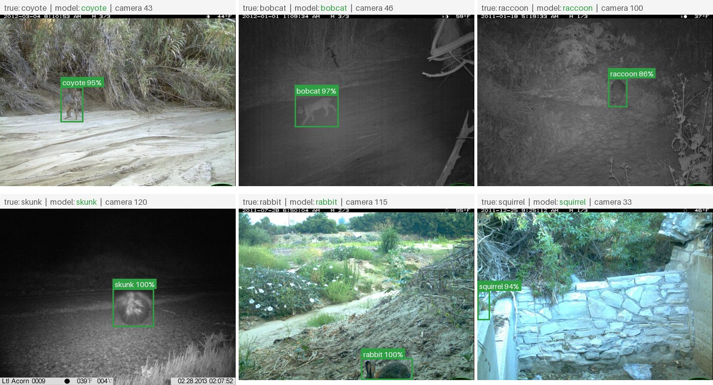
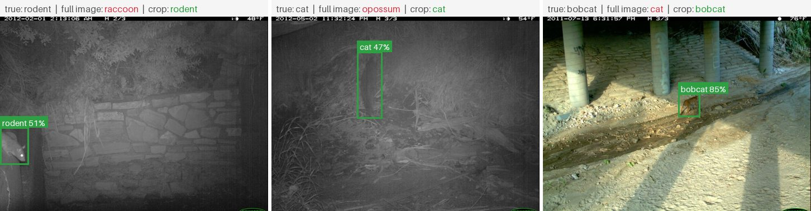
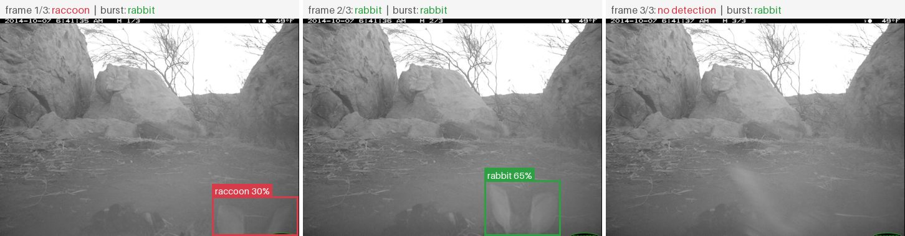
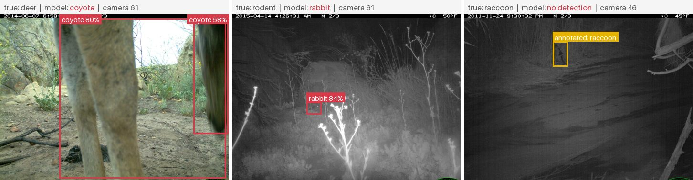

# Mammalcam

Automatic analysis of camera trap images: filter out empty frames, find animals, identify the species, and link each result to its profile in the [Mammalatlas](https://github.com/hannes-vnz/Mammalatlas).

> **Status:** work in progress. Results below will be filled in as each step is completed.

## Problem and why it matters

Camera traps are one of the main tools for monitoring wildlife, but a single survey produces hundreds of thousands of images, most of them empty. Sorting them by hand takes ecologists weeks. Automating the first passes (empty or not, which species) frees that time for the actual conservation work.

The hard part is not reaching a high accuracy on a test set, but reaching it on **cameras the model has never seen**. Background, lighting and camera angle differ per location, and a model can learn the location instead of the animal. This project measures that effect explicitly.

## Pipeline

1. **Detection (stage 1):** [MegaDetector](https://github.com/agentmorris/MegaDetector), pretrained, finds animals, people and vehicles. Not retrained here.
2. **Crops:** each animal detection is cut out of the image.
3. **Species classification (stage 2):** transfer learning with a pretrained backbone (via [timm](https://github.com/huggingface/pytorch-image-models)) on the crops. This is the core of the project.
4. **Output:** CSV per image and a small web demo.

All animal classes in the dataset are classified. Mammals are the focus, and only mammals with an unambiguous scientific name get a Mammalatlas link. Low-confidence predictions are reported as "uncertain" instead of a forced species.

## Examples

Real test images. Every prediction comes from the camera cross-validation, so the model never saw the camera of the image it labels. Boxes are MegaDetector's; each box shows the crop classifier's class and probability, **green** if it matches the annotated label, **red** if not. Generated by `python -m mammalcam.eval.examples`.

**Correct predictions on unseen cameras**, day and infrared night images:



**Why crops help.** The full-image model is fooled by the scene, the crop model sees only the animal:



**Why averaging over a burst helps.** The camera takes three frames per trigger. Two of them are wrong or empty on their own, the average over the burst is right:



**Failures.** A deer seen only as legs close to the lens, a rodent mistaken for a rabbit, and a raccoon that MegaDetector missed (yellow: the annotated box):



Images: [Caltech Camera Traps](https://lila.science/datasets/caltech-camera-traps), CDLA-Permissive 1.0, photographers Justin Brown and Erin Boydston (per image in [docs/examples/sources.csv](docs/examples/sources.csv)).

## Evaluation

- Train / validation / test split **by camera location**, never by random image.
- Comparison: the same model with a random split, to show how much accuracy would be overestimated.
- Accuracy, macro-F1, confusion matrix, per-species results (including rare species), error examples.
- Baseline: a classifier on full images without detector crops, to measure what stage 1 adds.
- **Specialist vs. generalist:** the same test cameras run through Google's [SpeciesNet](https://github.com/google/cameratrapai), a public model trained on over 65 million camera trap images with more than 2,000 labels. Question: does a small classifier trained on these cameras beat a large general-purpose model on new cameras from the same region? SpeciesNet's labels are mapped to the classes used here, and it runs in its own virtual environment to keep its dependencies apart.

## Data and licences

**[Caltech Camera Traps, CCT20 benchmark subset](https://lila.science/datasets/caltech-camera-traps)**, hosted by LILA BC. Licence: [Community Data License Agreement – Permissive 1.0](https://cdla.dev/permissive-1-0/). Images are not part of this repository; `python -m mammalcam.data.download cct20` fetches them (6.5 GB).

> Beery, S., Van Horn, G., Perona, P. (2018). *Recognition in Terra Incognita.* ECCV 2018.

57,864 images from 20 camera locations in the southwestern US, 15 classes plus "empty". Full overview: [reports/01_dataset.md](reports/01_dataset.md).

What matters for this project:

- **Heavy class imbalance.** Opossum alone is 24 % of the images; badger (22 images) and fox (8) are too rare to learn.
- **Some classes exist at only two cameras** (car, deer, fox), so they cannot be in train, validation and test at the same time.
- **Only 7 % empty images.** The benchmark was pre-filtered; real deployments are often 70 % empty or more. The empty filter is therefore not tested under realistic conditions here.
- **Images come in bursts** of mostly three frames. Frames of one burst are near-duplicates.

### Splits

`python -m mammalcam.data.split` builds three splits with identical sizes (34,410 / 8,738 / 14,716 images):

| Strategy | What is separated | Shared cameras | Shared bursts |
|---|---|---|---|
| `location` (used for all results) | whole cameras: 12 train, 3 val, 5 test | 0 | 0 |
| `random_sequence` (comparison) | whole bursts | 20 | 0 |
| `random_image` (comparison) | single images | 20 | 13,395 |

The cameras for each part are chosen by a seeded search so that every class seen at two or more cameras appears in both train and test; the result is stored in [configs/splits_cct20.json](configs/splits_cct20.json).

## Results

### Stage 1: MegaDetector on a 500-image sample

MegaDetector v5a, pretrained, on a class-balanced sample (one image per burst, all 20 cameras). Full tables: [reports/02_megadetector_sample.md](reports/02_megadetector_sample.md).

- **Boxes:** where every animal has an annotated box, MegaDetector finds 97 % of them at threshold 0.2 (precision 97 %, mean IoU 0.85).
- **Image level:** it flags 87 % of the images labelled with an animal. But 50 of the 55 misses are frames without an annotated box. CCT labels whole bursts, so the last frame often shows the empty scene after the animal has left. On images with a box it misses 5 of 365.
- **"Empty" images:** 8 of 32 get a detection. Looking at them, most contain an animal after all (a close-up, a tail, a skunk at the edge) or a person. These are label errors, not detector errors.
- **Speed:** about 1 image per second on an M-series MacBook (MPS). The whole dataset would take about 16 hours locally.

Caveat: MegaDetector was trained on data that includes Caltech Camera Traps, so these numbers are probably better than on cameras it has never seen.

### Crops for the species classifier

To avoid 16 hours of local inference, the crops use [LILA's precomputed MegaDetector v5a results](https://lila.science/megadetector-results-for-camera-trap-datasets/) for Caltech Camera Traps (`python -m mammalcam.data.download cct-md`, 5 MB). They agree with the own run on the 500-image sample: 98 % same animal / no-animal decision, matched boxes at mean IoU 0.97.

`python -m mammalcam.crops.make_crops` turns every animal detection (confidence ≥ 0.2) into a padded square crop. Details: [reports/03_crops.md](reports/03_crops.md).

- **47,099 crops** from 45,039 images. 95 % of the labels are confirmed by an annotated box; detections on images with complete boxes that match none of them (rocks, branches) are dropped.
- **12 % of the animal images give no crop.** Most are burst frames after the animal has left; for rodents it is 33 %, because small animals are detected less often.
- **Hard cases for the classifier:** rodents have 101 training crops but 417 test crops, dogs only 41 validation crops. Fox (1 training crop) and badger (16) are too rare to train on.

### Baseline: full images, no detector

12 classes ([configs/classes_cct20.json](configs/classes_cct20.json)), 51,129 images with exactly one of them. Frozen `convnext_tiny.fb_in22k` embeddings of the whole image (resized to 224 × 224) plus logistic regression. The same embeddings are used for every split, so the differences come from the split alone. Details: [reports/04_baseline.md](reports/04_baseline.md).

| Split | Test images | Accuracy | Macro-F1 |
|---|---|---|---|
| **by camera** (unseen cameras) | 12,407 | **0.49** | **0.43** |
| random by burst | 12,980 | 0.77 | 0.77 |
| random by image | 12,998 | 0.81 | 0.81 |

**A random split would overstate accuracy by about 32 points.** Most of the gap (28 points) comes from seeing the same cameras in training and test; near-identical burst frames add another 4. On a new camera the whole-image model fails badly: all 636 rodent test images come from camera 33, and 496 of them are classified as raccoon.

The number also depends a lot on which cameras end up in the test set. Accuracy per test camera ranges from 0.34 to 0.87, and macro-F1 is 0.24 on the 3 validation cameras but 0.43 on the 5 test cameras. A single split of 20 cameras is not enough for a stable estimate, so the next results use cross-validation over camera groups.

### Species classifier on MegaDetector crops

Same frozen backbone and the same kind of classifier as the baseline. The only difference is the input: MegaDetector crops instead of the whole image. Trained on the labelled crops; tested end to end on every MegaDetector detection of the test images, with no ground-truth boxes involved. An image without any detection (11 % of test images) counts as wrong. Optionally the predictions are averaged over each burst. Details: [reports/05_crop_classifier.md](reports/05_crop_classifier.md).

**Main result: 5-fold cross-validation over camera groups.** Every camera is in the test group exactly once (51,129 test images in total).

| Model | Accuracy | Macro-F1 |
|---|---|---|
| full image (baseline) | 0.46 ± 0.05 | 0.32 ± 0.06 |
| full image + burst average | 0.49 ± 0.05 | 0.33 ± 0.06 |
| MegaDetector crops | 0.71 ± 0.07 | 0.61 ± 0.06 |
| **MegaDetector crops + burst average** | **0.82 ± 0.05** | **0.69 ± 0.05** |

Mean ± standard deviation over the 5 folds.

- **Stage 1 pays off clearly:** cropping raises accuracy on unseen cameras from 0.46 to 0.71, and the crop model is better than the baseline at every one of the 20 cameras. Averaging over a burst adds another 11 points, partly because it fills in frames where the animal has left or is hard to see.
- **Crops make the model less dependent on the camera.** On the single split, a random split overstates the full-image model by 32 points (0.49 → 0.81) but the crop model by only 10 points (0.70 → 0.80). Without the background there is less to memorise.
- **Rare and look-alike classes stay hard:** deer F1 0.26 (207 images from 2 cameras, mostly confused with coyote), rodent 0.45. Common species reach 0.82–0.91.
- **Spread between cameras is large:** accuracy per camera ranges from 0.65 to 0.95 for crops + burst average.

## Limitations

Pending.

## Run it

Requires Python 3.10 or newer (the project pins 3.12 in `.python-version`). With [uv](https://docs.astral.sh/uv/):

```bash
uv venv --python 3.12 .venv
source .venv/bin/activate
uv pip install -e ".[detect,demo,dev]"
pytest
```

Plain `python3 -m venv .venv` and `pip install -e ".[detect,demo,dev]"` work as well.

## Project structure

```
configs/     # dataset, class list, class → scientific name for Mammalatlas links
src/mammalcam/
  data/      # download, metadata parsing, location-based split
  detect/    # MegaDetector inference
  crops/     # crops from detections, label assignment
  models/    # baseline and species classifier
  eval/      # metrics, confusion matrix, error examples
  export/    # CSV output
notebooks/   # exploration, MegaDetector sample, training notebook for Kaggle / Colab
app/         # Gradio demo
tests/       # tests for data preparation
data/        # not tracked, see data/README.md
```

## Licence

Code: MIT, see [LICENSE](LICENSE). Datasets keep their own licences (see above).
